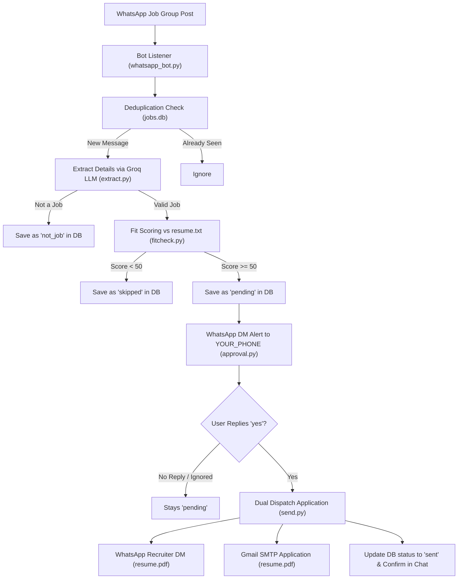

# ⚡ PingApply

> **Your Autonomous AI Job Scout on WhatsApp.**  
> Monitors WhatsApp groups for job postings, parses requirements with Groq LLM, scores match quality against your resume, alerts you via private WhatsApp message, and dispatches your application upon your approval.

[](https://www.python.org/)
[](LICENSE)
[](https://groq.com/)
[](https://github.com/krypton-byte/neonize)
[](https://docs.astral.sh/uv/)

---

## 📌 Architecture & Workflow



---

## ✨ Features

- 🧠 **Smart Job Extraction**: Uses ultra-fast Groq LLMs (`openai/gpt-oss-120b`, `llama-3.3-70b-versatile`, etc.) to parse unstructured group chatter into structured JSON (role, skills, location, recruiter phone, recruiter email).
- 🎯 **Resume Match Scoring (0–100)**: Evaluates incoming job specifications against your personal `resume.txt` and generates a fit percentage and written reasoning.
- 🔔 **Zero-Spam Human-in-the-Loop Alerts**: When a job matches with a score $\ge 50$, the bot pings your personal WhatsApp with a short, clean daily ID (`#1`, `#2`, `#3`...).
- 🗓️ **Automatic Daily Reset**: Job IDs reset every day at midnight so numbers stay short and clean. Daily jobs can only be applied to on the day they appeared.
- 🚀 **Streamlined Command Dispatch (`yes <id> <wa/email/both>`)**:
  - `yes 1 both` — sends your resume via both WhatsApp & Email.
  - `yes 1 wa` — sends your resume strictly via WhatsApp.
  - `yes 1 email` — sends your resume strictly via Email.
  - Or simply `yes` / `yes 1` to default to all available contacts.
- 💾 **Local SQLite Storage**: Deduplicates messages using message IDs and logs all jobs, scores, timestamps, and application statuses in `jobs.db`.
- 🔒 **100% Local & Privacy-Friendly**: No third-party backend servers. All credentials, session tokens, and database files stay on your machine.

---

## 💬 Interactive Approval Example

When matching opportunities arrive, you receive direct WhatsApp alerts numbered consecutively for the day:

```text
🎯 Job Match #1 (78%): Full Stack Python Engineer @ Remote / Bangalore
• WhatsApp: +91 98765 43210
• Email: jobs@techcorp.io

Reply with:
• yes 1 both   (Send to WhatsApp + Email)
• yes 1 wa     (WhatsApp only)
• yes 1 email  (Email only)
```

You can choose your channel simply by texting back:
```text
yes 1 wa
```

The bot immediately dispatches your resume and confirms:
```text
Application sent for Job #1 (Full Stack Python Engineer) via WhatsApp (+919876543210)!
```

---

## 🚀 Quickstart Guide

### 1. Prerequisites

- Python **3.11 or higher** installed.
- [`uv`](https://docs.astral.sh/uv/) installed (recommended for fast package management):
  ```powershell
  # Windows (PowerShell)
  powershell -ExecutionPolicy ByPass -c "irm https://astral.sh/uv/install.ps1 | iex"
  
  # macOS / Linux
  curl -LsSf https://astral.sh/uv/install.sh | sh
  ```

### 2. Clone the Repository

```bash
git clone https://github.com/VekariaNeel/pingapply.git
cd pingapply
```

### 3. Install Dependencies

Using `uv`:
```bash
uv sync
```
*(Or with standard pip: `python -m venv .venv && source .venv/bin/activate && pip install -e .`)*

### 4. Configure Environment

Copy the example configuration:
```bash
cp .env.example .env
```

Open `.env` and fill in your configuration:

```env
# Get a free key at https://console.groq.com/keys
GROQ_API_KEY=gsk_your_groq_api_key_here

# Groq model for extraction & scoring
GROQ_MODEL=openai/gpt-oss-120b

# Your phone number with country code (no + or special characters)
YOUR_PHONE=919876543210

# Target group JID (obtained in Step 6)
TARGET_GROUP_JID=120363xxxxxxxxxxxx@g.us

# Optional: Gmail SMTP settings for email applications
GMAIL_USER=your_email@gmail.com
GMAIL_APP_PASSWORD=your_16_char_app_password
```

### 5. Add Your Resume

1. **`resume.txt`**: Create a plain-text version of your resume in the project root (see [`resume.example.txt`](resume.example.txt) for reference). This is used by the LLM for match scoring.
2. **`resume.pdf`**: Place your formatted PDF resume named `resume.pdf` in the project root. This is the document sent to recruiters.

### 6. Link WhatsApp & Find Target Group

Run the group discovery utility:
```bash
uv run python find_group.py
```

1. A **QR code** will display in your terminal.
2. Open WhatsApp on your phone $\rightarrow$ **Settings** $\rightarrow$ **Linked Devices** $\rightarrow$ **Link a Device** and scan the QR code.
3. The script will output all joined groups with their respective **JID**s:
   ```text
   ============================================================
    Found 5 groups
   ============================================================
     Tech Jobs & Internships
     JID: 120363426790534673@g.us
     --------------------------------------------------------
   ```
4. Copy the group JID and set it as `TARGET_GROUP_JID` in your `.env`.

### 7. Run the Bot

Start the listener:
```bash
uv run python main.py
```

The bot will connect to WhatsApp and log incoming job posts in real time!

---

## 📧 Email Service Setup (Gmail SMTP)

The bot uses Python's built-in `smtplib` over **Port 587 with STARTTLS** to send resumes to recruiter email addresses.

> [!IMPORTANT]
> **Your standard Google login password will NOT work.** Google blocks automated SMTP logins with regular passwords. You must generate a dedicated **16-character App Password**.

### Step-by-Step Instructions:

1. **Enable 2-Step Verification**:
   - Go to your [Google Account Security Settings](https://myaccount.google.com/security).
   - Ensure **2-Step Verification** is turned **ON**. (App Passwords are unavailable if 2-Step Verification is off).

2. **Generate an App Password**:
   - Open [Google App Passwords](https://myaccount.google.com/apppasswords).
   - In the **App name** field, enter something recognizable like `PingApply`.
   - Click **Create**.
   - Google will show a yellow box with a **16-character password** (e.g. `juzq qyiv rdhl zpxd`).

3. **Add to `.env`**:
   - Copy the 16 characters (spaces are optional) into your `.env` file:
     ```env
     GMAIL_USER=your_email@gmail.com
     GMAIL_APP_PASSWORD=juzqqyivrdhlzpxd
     ```

4. **Verify Your Connection (Optional Test)**:
   - Run this one-line command to verify that your credentials authenticate successfully without sending an email:
     ```powershell
     uv run python -c "from dotenv import load_dotenv; load_dotenv(); import os, smtplib; smtp = smtplib.SMTP('smtp.gmail.com', 587, timeout=10); smtp.starttls(); smtp.login(os.environ['GMAIL_USER'], os.environ['GMAIL_APP_PASSWORD']); print('✅ Gmail SMTP connected and authenticated successfully!'); smtp.quit()"
     ```

5. **Customizing Your Email Template**:
   - To personalize the subject line, email body text, or sign-off, open [`send.py`](send.py) and edit the `send_email` function:
     ```python
     msg["Subject"] = f"Application for {role_name}"
     msg.set_content(f"Hi,\n\nI'm applying for the {role_name} role. Resume attached.\n\nThanks,\nYour Name")
     ```

---

## ⚙️ Configuration Reference

| Variable | Description | Required | Example |
| :--- | :--- | :---: | :--- |
| `GROQ_API_KEY` | Groq Cloud API Key | **Yes** | `gsk_abc123...` |
| `GROQ_MODEL` | LLM model used for parsing & scoring | No | `openai/gpt-oss-120b` |
| `YOUR_PHONE` | Your personal WhatsApp phone number | **Yes** | `919876543210` |
| `TARGET_GROUP_JID` | WhatsApp group JID to monitor | **Yes** | `120363426790534673@g.us` |
| `GMAIL_USER` | Gmail address for sending applications | No | `candidate@gmail.com` |
| `GMAIL_APP_PASSWORD` | Google Account 16-character App Password | No | `abcd efgh ijkl mnop` |


---

## 📂 Project Structure

```text
pingapply/
├── main.py              # Main orchestrator & message dispatcher
├── whatsapp_bot.py      # Neonize WhatsApp connection & listener
├── find_group.py        # Utility to list WhatsApp groups and JIDs
├── extract.py           # Job post parsing via Groq LLM
├── fitcheck.py          # Resume-to-job match scoring engine
├── approval.py          # WhatsApp DM alert formatting
├── send.py              # WhatsApp & Gmail application delivery
├── db.py                # SQLite database management (jobs.db)
├── resume.example.txt   # Reference resume structure template
├── .env.example         # Environment template with instructions
├── pyproject.toml       # Python package metadata & dependencies
└── LICENSE              # MIT License
```

---

## 🛠️ Troubleshooting

#### 1. `Got 401: logged out from another device`
If your session expired or was unlinked from WhatsApp on your phone:
```bash
# Delete the old session file
rm auth.db*

# Re-run find_group.py to scan a fresh QR code
uv run python find_group.py
```

#### 2. `groq.NotFoundError: Error code: 404`
Ensure `GROQ_MODEL` in `.env` is set to an active model available on your Groq tier (such as `openai/gpt-oss-120b` or `qwen/qwen3.8-27b`).

#### 3. Recruiter phone number missing country code
Numbers posted with 10 digits (common in India) are automatically normalized with country code `91`. If you operate in another country, update the default prefix in [`send.py`](send.py).

---

## 🛡️ License

This project is licensed under the [MIT License](LICENSE).

